# Lagos Property Market Analysis (Python + Power BI)
This project scraped, cleaned and analyzed property listings for sale and for rent in Lagos, Nigeria, from Nigeria Property Centre (nigeriapropertycentre.com). The goal was to answer a question many people in Lagos ask: what does property really cost here, and what drives the price? The full pipeline runs in Python, from web scraping to exploratory analysis, and finishes with an interactive Power BI dashboard.

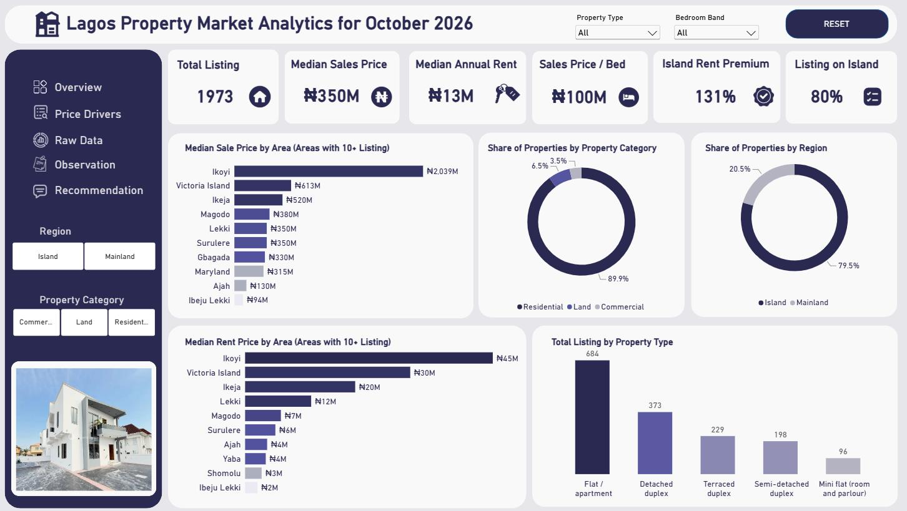

## 🔍 Overview
This project builds an original dataset by web scraping (Requests + BeautifulSoup), cleans it in pandas, and performs exploratory data analysis (EDA) to compare prices across areas, property types, bedroom counts and the Island–Mainland divide. Sale and rent listings are always analyzed separately, because they are different markets (about ₦350M to buy against about ₦13M a year to rent).

The goal is to show buyers, renters, landlords and investors where prices are highest, where they get the most value for money, and where renting out a property pays best.

## 📌 Objectives

- Scrape at least 1,000 property listings using Python (Requests and BeautifulSoup)
- Clean the data: handle missing values, remove duplicates, fix data types and correct inconsistencies
- Explore prices across areas, property types, bedroom counts and Island vs. Mainland
- Create at least seven meaningful visualizations
- Build an interactive Power BI dashboard and share observations and recommendations

## ❓ Business Questions

1. Which areas are the most expensive to buy and to rent a home?
2. Which property types cost the most?
3. How much more expensive is the Island than the Mainland?
4. How does price change with the number of bedrooms?
5. Which areas offer the best value per bedroom?
6. Where does renting out a property give the best return (gross rental yield)?
7. How do price, bedrooms, bathrooms, toilets and parking relate to each other?
8. How skewed are prices, and what is a fair "typical" price?

## 📚 Dataset Description
**Source:** nigeriapropertycentre.com, Lagos listings for sale (`/for-sale/lagos`) and for rent (`/for-rent/lagos`), collected on 10 October 2026.

- **Raw data:** 2,038 listings × 18 columns
- **Clean data:** 1,973 listings × 23 columns (1,000 for sale, 973 for rent, 37 areas)
- **Key columns:** listing type, title, property type, property group, price (₦), bedrooms, bathrooms, toilets, parking, neighbourhood, area, region (Island / Mainland), outlier flag

## 🛠 Tools & Technologies Used

- Python
- Requests & BeautifulSoup: web scraping
- Pandas & NumPy: data cleaning and analysis
- Matplotlib & Seaborn: visualization
- Jupyter Notebook & VS Code
- Power BI & DAX: interactive dashboard

## 📁 Repository Structure

| Folder / File | Contents |
|---|---|
| `data/lagos_properties_raw.csv` | Raw scraped listings |
| `data/lagos_properties_clean.csv` | Cleaned dataset (1,973 rows × 23 columns) used for the analysis and dashboard |
| `notebooks/01_lagos_property_scraper.ipynb` | Web scraper (Requests + BeautifulSoup) |
| `notebooks/02_data_cleaning.ipynb` | Data cleaning with pandas |
| `notebooks/03_eda_and_visualisation.ipynb` | Exploratory data analysis and 9 charts |
| `charts/` | All charts exported from the EDA notebook |
| `dashboard/` | Screenshots of the Power BI dashboard |
| `report/Lagos_Property_Project_Report.pdf` | Full project report |

**To run the notebooks:** the notebooks read and write the CSV files in their own folder, so copy the files from `data/` into `notebooks/` first (or run the scraper to generate a fresh raw file).

## 🕸 Web Scraping

- Visited the "for sale" and "for rent" search pages for Lagos, page by page, up to the site's limit of 50 pages each.
- Found each listing by matching the listing link pattern and climbing up the HTML to the block holding only that listing, instead of relying on CSS class names that change often.
- Used regular expressions to extract price and currency, property type, location, bedrooms, bathrooms, toilets, parking and size.
- Waited 2–4 seconds between pages, retried failed requests, skipped repeated listings and saved progress after every page.
- **Challenge:** the site blocked Google Colab (403 error), so the scraper was run locally in VS Code.

## 🧹 Data Cleaning and Preparation

- Removed 24 near-duplicates (the same property re-posted under a new ID).
- Converted text prices to numbers, fixed 2 naira prices wrongly labelled in dollars (including a "$4.5 billion" house), and converted 80 genuine US-dollar listings to naira at ₦1,332/$ (official CBN rate, 8 October 2026).
- Removed 39 prices that were not full prices (per-square-metre, monthly, or sale prices posted as rent).
- Split the free-text location into neighbourhood and area, standardised area names, and dropped 2 rows whose location was an agent's company name.
- Added a region column (Island / Mainland) and grouped 25 property types into simpler categories.
- Filled missing bedrooms for homes from the title (47) and the property-type median (21); left land and commercial empty on purpose, since they have no bedrooms.
- Filled missing bathrooms and toilets for homes using the median for homes with the same bedroom count.
- Set missing parking to 0 ("not stated") and dropped unusable columns (price unit, size, date added).
- Flagged 31 outliers with the IQR method on log price (separately for sale and rent) instead of deleting them, since luxury properties are real.

**Result:** 2,038 → 1,973 rows (3.2% removed), 18 → 23 columns.

## 📈 Key Findings

#### - Most Expensive Area:
Ikoyi is the priciest area to both buy and rent, with a median sale price of about ₦2 billion and a median rent of about ₦45M a year, more than three times the next area for sale.
#### - Skewed Prices:
The mean sale price is ₦925M but the median is only ₦350M, because a small number of luxury listings pull the average up. Medians are used throughout.
#### - Island vs. Mainland:
Island rents are 131% higher than Mainland rents, but median sale prices are almost the same (₦370M vs. ₦350M), because the Island includes both premium areas (Ikoyi) and lower-priced ones (Ajah, Ibeju Lekki).
#### - Bedrooms and Price:
Price rises with each extra bedroom and jumps sharply above 4 bedrooms (₦310M for 4 bedrooms vs. ₦740M for 5). The correlation between bedrooms and sale price is 0.42.
#### - Price per Bedroom:
A bedroom in Ikoyi costs a median of about ₦450M, almost five times Lekki (₦95M) and about ten times Ajah.
#### - Rental Yield:
Victoria Island (5.0%) and Ikeja (4.4%) give landlords the best gross rental yield, while Ikoyi returns only about 2.3%.
#### - Data Concentration:
Lekki accounts for nearly half of all listings (919 of 1,973), and about 80% of listings are on the Island.

## 📊 Visualizations

| | |
|---|---|
| 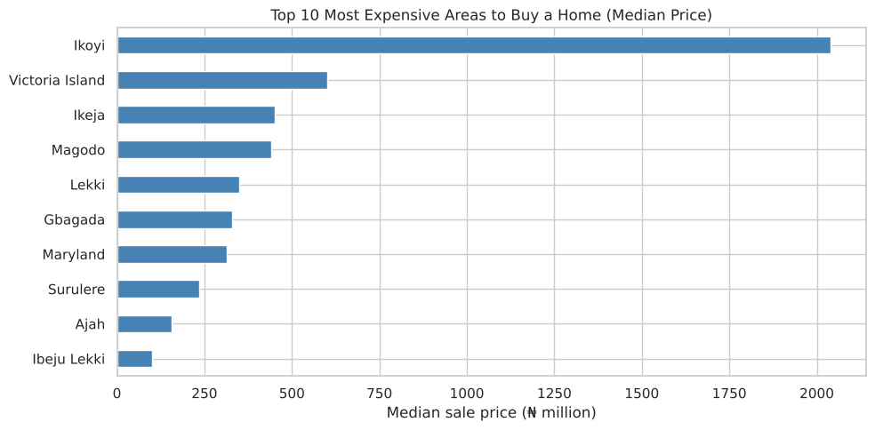 | 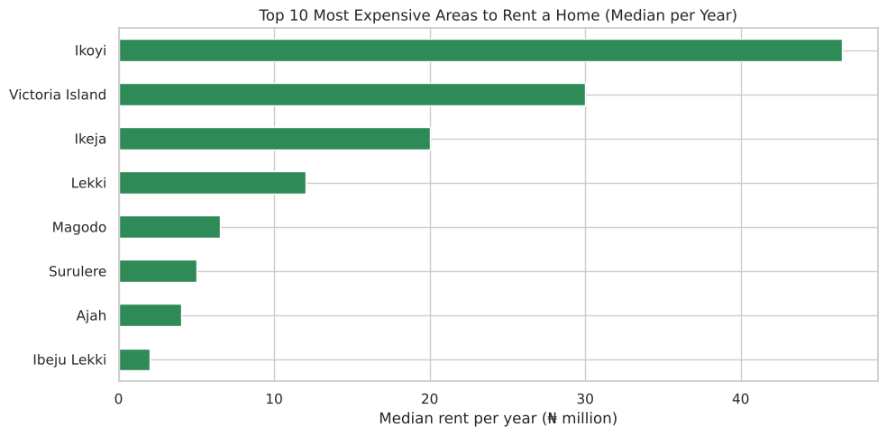 |
| 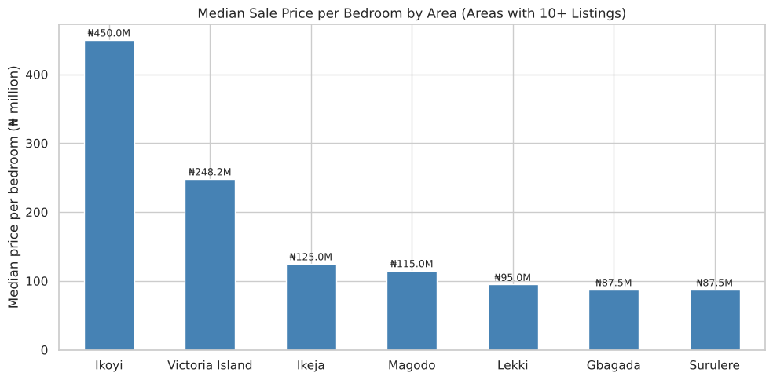 | 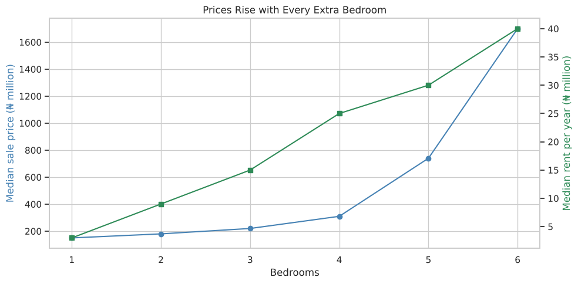 |
| 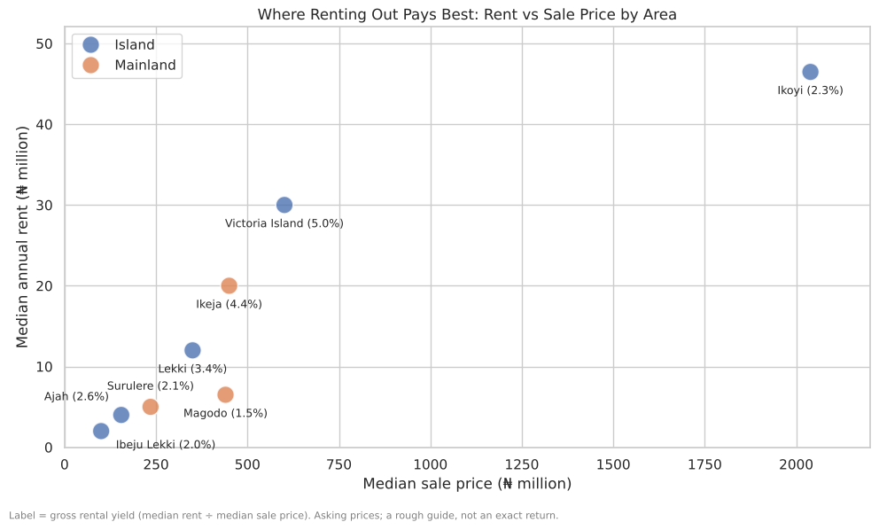 | 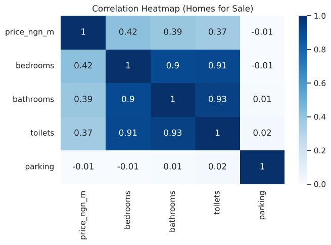 |
| 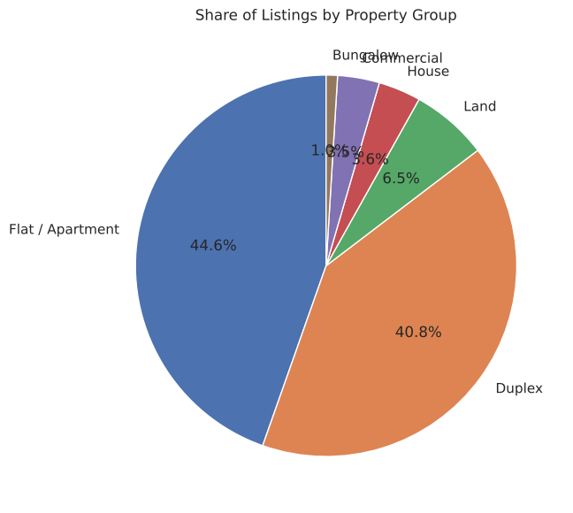 | 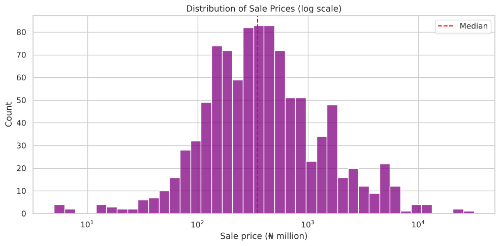 |
| 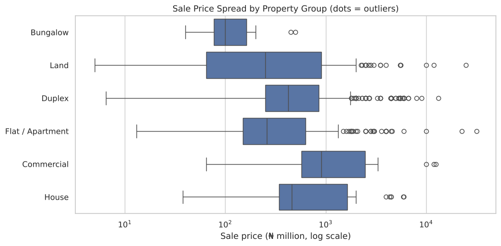 | |

## 🖥 Power BI Dashboard

A two-page interactive dashboard built on the cleaned data, with DAX measures such as Median Sale Price, Median Annual Rent, Island Rent Premium % and Gross Rental Yield %.

- **KPI cards:** total listings, median sale price, median annual rent, sale price per bedroom, Island rent premium, share of listings on the Island
- **Page 1 (Market Overview):** median sale price and rent by area, listings by property category, region and property type
- **Page 2 (Price Drivers):** rental yield scatter plot, price per bedroom by area, price by bedroom count, correlation heatmap
- **Interactivity:** navigation buttons, slicers (region, property category, property type, bedroom band), reset button, cross-filtering and tooltips

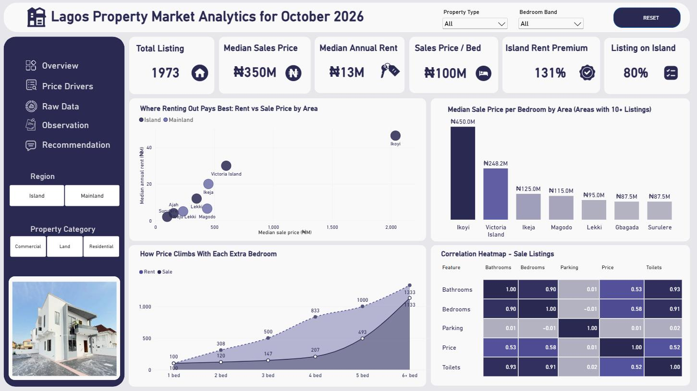

## 💡 Recommendations

1. Investors seeking rental income should look at Victoria Island and Ikeja, which offer the highest gross rental yields, rather than Ikoyi.
2. Premium buyers in Ikoyi should treat their purchase as a long-term capital asset, since returns there depend mainly on price growth rather than rent.
3. First-time buyers and budget-conscious families should consider Ajah and Ibeju Lekki, which have the lowest median sale prices among the top 10 areas.
4. Renters looking for value should consider Mainland areas such as Magodo, Surulere and Yaba, where median rents are well below the Island median.
5. Compare price per bedroom, not just total price, to find genuine value across locations.
6. Use the median, not the average, when judging a fair price.
7. Property platforms should consistently record the price unit, parking, property size and number of units in multi-unit buildings.

## ⚠️ Limitations

- All listings were collected on a single day, so no price trend over time is possible.
- The sample leans towards the Island and Lekki, because the website shows promoted listings first.
- Prices are asking prices, which may differ from final sale or rent prices.
- Rent is assumed to be annual, and one exchange rate is used for all dollar listings.

## 🚀 Next Steps

- Run a scheduled monthly scrape to track price and rent trends over time
- Collect more Mainland listings for a more balanced sample
- Improve the scraper to capture the price unit and property size
- Build a simple price prediction model (e.g. regression on location, property type and bedrooms)
- Publish the dashboard to the Power BI Service

## 👤 Author
**Ogunsola Oluwafemi Nehemiah**
GitHub: [nehemiah304](https://github.com/nehemiah304)
